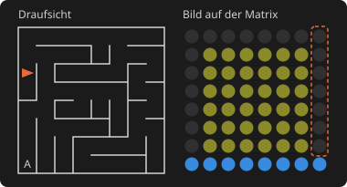
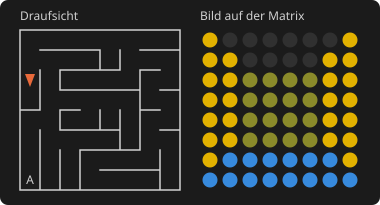
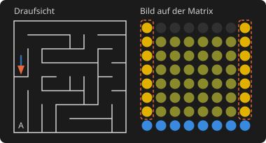
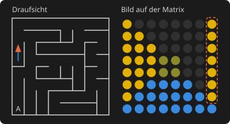
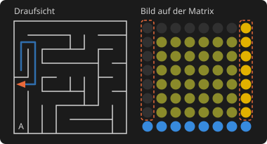
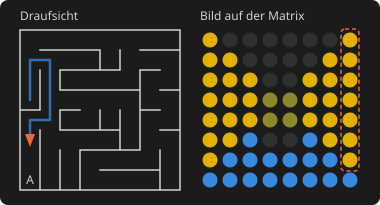
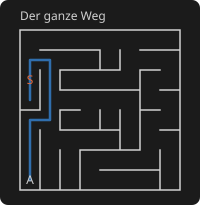

# Maze2090

3D-Irrgarten für den Busch Microtronic 2090 mit dem [ESP2090 Studio](https://github.com/rab-berlin/ESP2090) (8x8-LED-Matrix mit Farben): Blick aus der Ich-Perspektive wie bei *3D Monster Maze*, bedient mit den Tasten des 2090.

- 253 Programmschritte, 3 frei
- Dateien: [irrgarten.mic](irrgarten.mic), das kommentierte Listing, und das Userscript [irrgarten_farben.py](irrgarten_farben.py) für die Farben
- Getestet im [Emulator2090](https://github.com/rab-berlin/Emulator2090), noch nicht am Gerät

## Spiel

- **Irrgarten:** 8x8 Räume, jedes Mal neu ausgewürfelt. Zwischen zwei Räumen gibt es immer genau einen Weg.
- **Start:** in einem zufälligen Raum mit zufälliger Blickrichtung.
- **Ausgang:** der Raum in der Südwest-Ecke. Ist er im Blick, hat der Boden direkt vor der Stirnwand ein dunkles Loch.
- **Geschafft:** Wer in den Ausgang geht, bekommt sofort einen neuen Irrgarten.

## Bild

- **Sichttiefe:** 3 Räume. Bleibt die Mitte dunkel, geht der Gang noch weiter.
- **Boden:** blau, die untersten drei Zeilen mit 8, 6 und 4 LEDs.
- **Seitenwände:** gelb, in Spalte 1/8, 2/7 und 3/6 für den 1., 2. und 3. Raum. Eine Öffnung zur Seite bleibt dunkel.
- **Stirnwand:** oliv (ein dunkles Gelb, wie dieselbe Mauer im Schatten), ein Quadrat in der Mitte mit 6, 4 oder 2 LEDs Kante, je nach Entfernung.

## Bedienung

| Taste | Wirkung |
|---|---|
| 1 | links drehen |
| 2 | einen Raum vor (vor einer Wand geschieht nichts) |
| 3 | rechts drehen |
| 0 | umdrehen |

Ein Blick braucht etwa 2,6 Sekunden, dann wartet das Programm auf die nächste Taste. Taster werden nicht gebraucht; Eingang 1 ist REQ der Matrix.

Der Irrgarten ist komplex genug, um sich zu verirren - Mission accomplished 😄 

Wenn du Glück hast, ist deine Startposition nahe am Ausgang, und wenn du richtig Glück hast, kannst du den Ausgang sogar direkt sehen. Wenn nicht, dann solltest du eine Strategie haben... da Ariadne gerade Urlaub hat, vielleicht einfach Papier und Bleistift, ganz wie früher...

Dass nach dem Finden des Ausgangs gleich ein neuer Irrgarten kommt, scheint vielleicht etwas unfair - ist aber letztlich nur eine Analogie des Lebens.

## Strategie: die rechte Hand an der Wand

Wer keinen Plan zeichnen will, kommt mit einer einfachen Regel immer ans Ziel: Eine Hand bleibt an der rechten Wand. In jedem Raum wird in dieser Reihenfolge geprüft:

1. Rechts offen: Taste 3, dann 2.
2. Sonst vorn frei: Taste 2.
3. Sonst links offen: Taste 1, dann 2.
4. Sonst Sackgasse: Taste 0, dann 2.

Das klappt, weil der Irrgarten keine Schleifen und keine Inseln hat: Die Regel führt an jeder Wand entlang und irgendwann in den Ausgang, egal wo der Start liegt. Im schlechtesten Fall läuft man fast jeden Gang zweimal ab. Die linke Hand geht genauso, nur wechseln darf man unterwegs nicht.

### Woran man es im Bild erkennt

- **Rechts:** Spalte 8. Leuchtet sie in Wandfarbe, ist dort Wand. Ist sie dunkel, ist dort eine Öffnung.
- **Vorn:** Das große Quadrat der Stirnwand (6x6 LEDs) heißt Wand direkt vor dir.
- **Links:** Spalte 1, genauso wie rechts.
- **Nur die äußeren Spalten zählen:** Dunkle Stellen in Spalte 7 oder 6 (oder 2 und 3) gehören zu Räumen weiter vorn.

### Ein Beispiel aus dem Programm

Die Bilder stammen aus einem Lauf im Emulator: links die Draufsicht mit dem bisherigen Weg, rechts das Bild auf der Matrix. Der gestrichelte Rahmen zeigt die Spalte, auf die es gerade ankommt.

**Rechts offen.** Spalte 8 ist dunkel, vorn steht die Stirnwand. Taste 3.

**Nach dem Drehen sofort vor.** Taste 2, ohne neu zu prüfen. Nach einer Rechtsdrehung liegt rechts, was eben hinter dir war, also meist der Gang, aus dem du kommst. Wer jetzt wieder „rechts offen“ liest, läuft zurück.

**Sackgasse.** Rechts, vorn und links Wand. Taste 0, dann 2. Die Regel führt in Sackgassen hinein und wieder heraus, das ist kein Fehler.

**Geradeaus.** Rechts ist Wand, vorn ist frei. Taste 2.

**Links offen.** Rechts Wand, vorn Wand, Spalte 1 ist dunkel. Taste 1, dann 2.

**Ausgang in Sicht.** Das dunkle Loch im Boden vor der Stirnwand. Jetzt darf man die Regel verlassen und geradeaus hineingehen.

Der ganze Weg dieses Beispiels, 17 Blicke vom Start bis zum Ausgang:

### Worauf man achten muss

- **Drehen und Gehen gehören zusammen:** nach 1, 3 oder 0 immer sofort 2.
- **Vor einer Wand tut sich nichts:** Taste 2 ändert dann das Bild nicht. Erst schauen, ob vorn frei ist, sonst verzählt man sich.
- **Auf das Bild warten:** Ein Blick braucht etwa 2,6 Sekunden. Die nächste Taste erst drücken, wenn das Bild steht.
- **Hand nie wechseln:** Wer zwischendurch auf links umsteigt, läuft dieselben Gänge noch einmal ab.

## Start

1. Matrix einschalten („LED on“ in der Weboberfläche).
2. Einmal nach dem Einschalten des ESP: das Userscript `irrgarten_farben.py` mit **Run** starten. Es setzt die Farben (Wände gelb, Boden blau) und endet sofort.
3. RESET, `HALT` `NEXT` `00` `RUN`. Nach etwa 6 Sekunden steht der erste Blick.

Für jeden weiteren RUN reichen RESET und RUN. Das Userscript braucht es nur noch einmal, wenn die Farben darin geändert wurden, wenn ein anderes Programm die Farben der Matrix verändert hat oder wenn der RESET mitten im Zeichnen kam.

Die Matrix muss wach sein. Hat ein anderes Programm sie schlafen gelegt, wartet der Irrgarten, bis sie geweckt wird.

**Ohne Userscript** läuft das Programm auch und bleibt spielbar: Wände und Boden sind dann beide rot, die Standardfarbe der Matrix. Die Stirnwand ist weiter oliv, das Loch am Ausgang weiter dunkel. So sieht es auch im Emulator2090 aus, der keine Userscripts kennt.

## Farben ändern

- **Wände und Boden:** im Userscript, `W = "gelb"` und `B = "blau"`. Möglich sind die Farbnamen von `setColors`. Nach einer Änderung das Userscript noch einmal starten, dann RESET und RUN. Hebt sich das dunkle Loch am Ausgang zu wenig vom blauen Boden ab, hilft `B = "tuerkis"`.
- **Stirnwand:** im Programm an Adresse 01, Befehl `1D8`. Die mittlere Ziffer ist die Farbnummer der Matrix (D = oliv).

## Technik

- **Speicher:** 1 Bit je Raum in den 16 Speicherregistern M0-MF. Bit 1 heißt Durchgang nach Osten. Die Bits teilen jede Reihe in Stücke, und aus jedem Stück führt genau ein Durchgang nach Norden: in den ungeraden Reihen am Ostende, in den geraden am Westende. Dadurch zeigen die Winkel reihenweise abwechselnd nach links und rechts.
- **Zeichnen:** Am Start legt das Programm die Farben des Userscripts auf den Stapel der Matrix. Je Blick sendet es ein Bild im Blockmodus (Wände und Boden) und zeichnet die Stirnwand als Rechteck. Gleich danach holt es die Farben vom Stapel zurück. Das ändert die Anzeige nicht, die Stirnwand bleibt sichtbar, aber im Speicher der Matrix stehen wieder die Grundfarben.
