# Maze2090

3D-Irrgarten für den Busch Microtronic 2090 mit dem [ESP2090 Studio](https://github.com/rab-berlin/ESP2090) (8x8-LED-Matrix mit Farben): Blick aus der Ich-Perspektive wie bei *3D Monster Maze*, bedient mit den Tasten des 2090.

- 256 Programmschritte, alle belegt
- Dateien: [irrgarten.mic](irrgarten.mic), das kommentierte Listing, und das Userscript [irrgarten_farben.py](irrgarten_farben.py) für die Farben
- Getestet im [Emulator2090](https://github.com/rab-berlin/Emulator2090), noch nicht am Gerät

## Spiel

- **Irrgarten:** 8x8 Räume, jedes Mal neu ausgewürfelt. Zwischen zwei Räumen gibt es immer genau einen Weg.
- **Start:** in einem zufälligen Raum mit zufälliger Blickrichtung.
- **Ausgang:** der Raum in der Südwest-Ecke. Ist er im Blick, hat der Boden direkt vor der Stirnwand ein rotes Loch.
- **Geschafft:** Wer in den Ausgang geht, bekommt sofort einen neuen Irrgarten.

## Start

1. Matrix einschalten („LED on“ in der Weboberfläche).
2. Einmal nach dem Einschalten des ESP: das Userscript `irrgarten_farben.py` mit **Run** starten. Es setzt die Farben (Wände gelb, Boden blau) und endet sofort.
3. RESET, `HALT` `NEXT` `00` `RUN`. Nach etwa 7 Sekunden steht der erste Blick.

Für jeden weiteren RUN reichen RESET und RUN. Das Userscript braucht es nur noch einmal, wenn die Farben darin geändert wurden, wenn ein anderes Programm die Farben der Matrix verändert hat oder wenn der RESET mitten im Zeichnen kam.

Die Matrix muss wach sein. Hat ein anderes Programm sie schlafen gelegt, wartet der Irrgarten, bis sie geweckt wird.

**Ohne Userscript** läuft das Programm auch und bleibt spielbar: Wände und Boden sind dann beide rot, die Standardfarbe der Matrix. Die Stirnwand ist weiter oliv. Das rote Loch am Ausgang ist auf dem roten Boden allerdings nicht zu sehen, man merkt den Ausgang erst, wenn man hineingeht. So sieht es auch im Emulator2090 aus, der keine Userscripts kennt.

## Bild

- **Sichttiefe:** 3 Räume. Bleibt die Mitte dunkel, geht der Gang noch weiter.
- **Boden:** blau, die untersten drei Zeilen mit 8, 6 und 4 LEDs.
- **Seitenwände:** gelb, in Spalte 1/8, 2/7 und 3/6 für den 1., 2. und 3. Raum. Eine Öffnung zur Seite bleibt dunkel.
- **Stirnwand:** oliv (ein dunkles Gelb, wie dieselbe Mauer im Schatten), ein Quadrat in der Mitte mit 6, 4 oder 2 LEDs Kante, je nach Entfernung.

## Bedienung

| Taste | Wirkung |
|---|---|
| 1 | links drehen |
| 2 | einen Raum vor (vor einer Wand geschieht nichts) |
| 3 | rechts drehen |
| 0 | umdrehen |

Ein Blick braucht etwa 3 Sekunden, dann wartet das Programm auf die nächste Taste. Taster werden nicht gebraucht; Eingang 1 ist REQ der Matrix.

Der Irrgarten ist komplex genug, um sich zu verirren - Mission accomplished 😄 

Wenn du Glück hast, ist deine Startposition nahe am Ausgang, und wenn du richtig Glück hast, kannst du den Ausgang sogar direkt sehen. Wenn nicht, dann solltest du [eine Strategie](#immer-an-der-wand-lang) haben... da Ariadne gerade Urlaub hat, vielleicht einfach Papier und Bleistift, ganz wie früher...

Dass nach dem Finden des Ausgangs gleich ein neuer Irrgarten kommt, scheint vielleicht etwas unfair - ist aber letztlich nur eine Analogie des Lebens.

## Farben ändern

- **Wände und Boden:** im Userscript, `W = "gelb"` und `B = "blau"`. Möglich sind die Farbnamen von `setColors`. Nach einer Änderung das Userscript noch einmal starten, dann RESET und RUN.
- **Stirnwand:** im Programm an Adresse 88, Befehl `1D8`. Die mittlere Ziffer ist die Farbnummer der Matrix (D = oliv).
- **Loch am Ausgang:** im Programm an Adresse 7C, Befehl `118` (1 = rot).

## Immer an der Wand lang...

Wer keinen Plan zeichnen will, kommt mit einer einfachen Regel immer ans Ziel: Eine Hand bleibt an der rechten Wand. In jedem Raum, den man betritt, wird einmal geprüft, in dieser Reihenfolge:

1. Rechts offen: nach rechts drehen (Taste 3) und einen Raum vor (Taste 2).
2. Sonst vorn frei: einen Raum vor (Taste 2).
3. Sonst links offen: nach links drehen (Taste 1) und einen Raum vor (Taste 2).
4. Sonst Sackgasse: umdrehen (Taste 0) und einen Raum vor (Taste 2).

Das klappt, weil der Irrgarten keine Schleifen und keine Inseln hat: Die Regel führt an jeder Wand entlang und irgendwann in den Ausgang, egal wo der Start liegt. Im schlechtesten Fall läuft man fast jeden Gang zweimal ab. Die linke Hand geht genauso, nur wechseln darf man unterwegs nicht.

### Woran man es im Bild erkennt

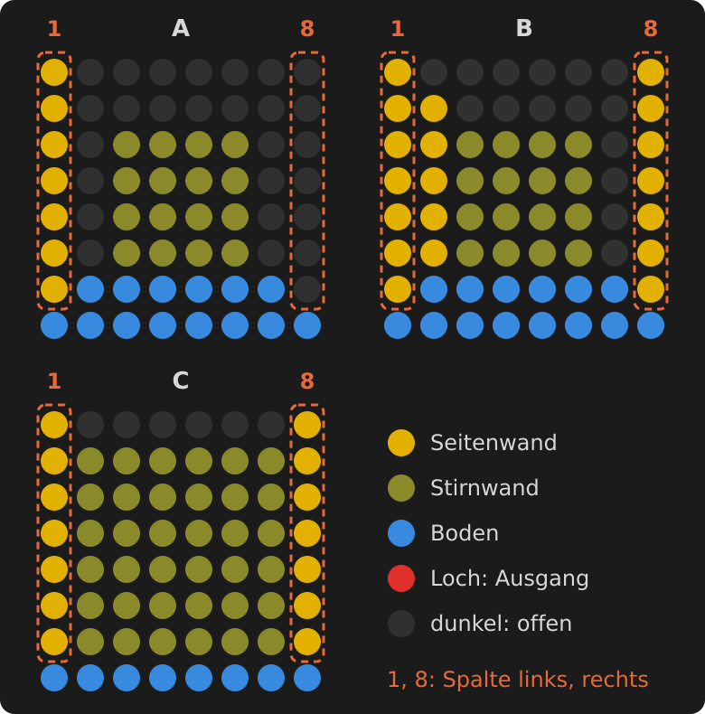

- **Rechts** ist Spalte 8, **links** ist Spalte 1. Leuchtet die Spalte in Wandfarbe, ist dort Wand. Ist sie dunkel, ist dort eine Öffnung.
- **Vorn** steht eine Wand, wenn das Quadrat der Stirnwand groß ist (6x6 LEDs). Ist es kleiner oder fehlt es, ist der nächste Raum frei.
- **Bild A:** rechts offen, links Wand, vorn frei (das Quadrat ist nur 4x4, die Stirnwand steht einen Raum weiter).
- **Bild B:** rechts und links Wand, vorn frei.
- **Bild C:** rechts, links und vorn Wand, eine Sackgasse.
- **Nur Spalte 1 und 8 zählen.** Dunkle Stellen in den Spalten daneben (in Bild B Spalte 7) sind Öffnungen weiter vorn.

### Ein Beispiel, Blick für Blick

Ein Lauf aus dem Emulator, 13 Blicke vom Start bis zum Ausgang. Jedes Bild zeigt links die Draufsicht (Pfeil: wo man steht und wohin man schaut, blaue Linie: der Weg bisher, A: der Ausgang) und rechts das Bild auf der Matrix. Darunter steht, was man sieht und welche Taste man drückt. Das nächste Bild zeigt, was nach dieser Taste erscheint.

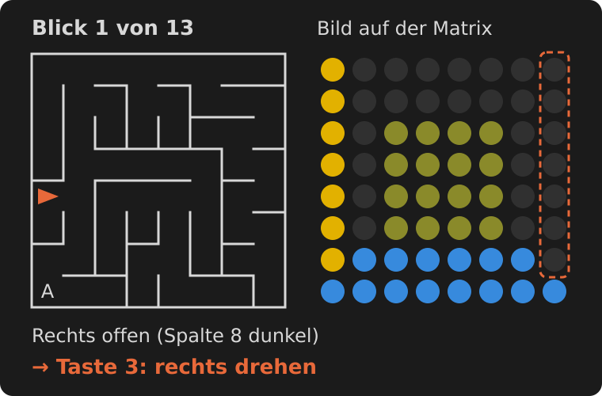 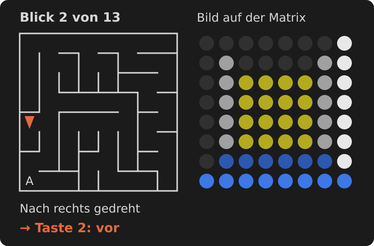
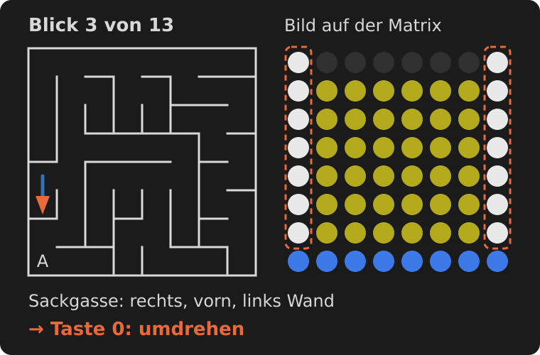 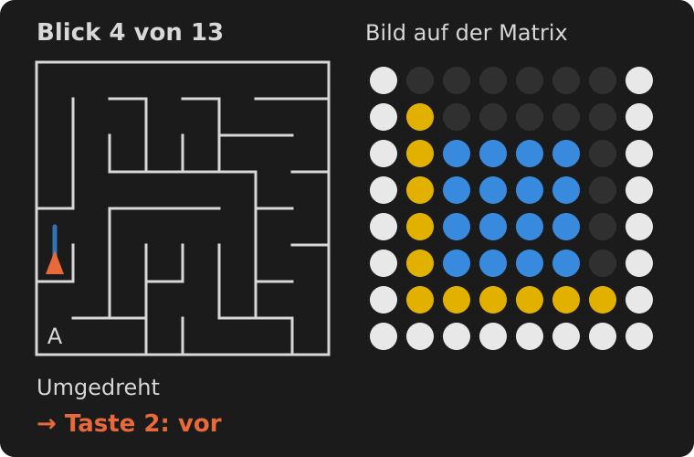
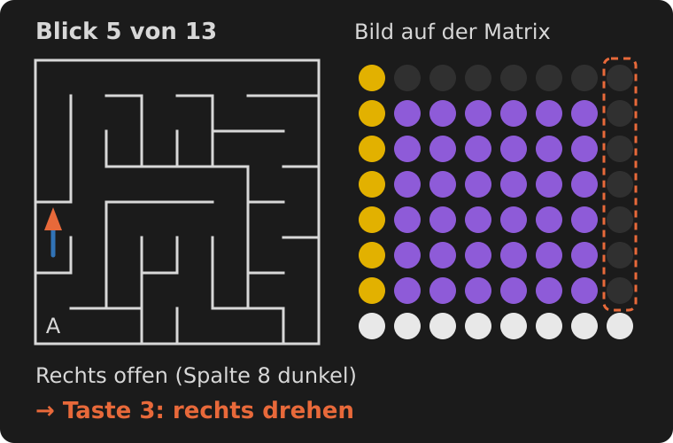 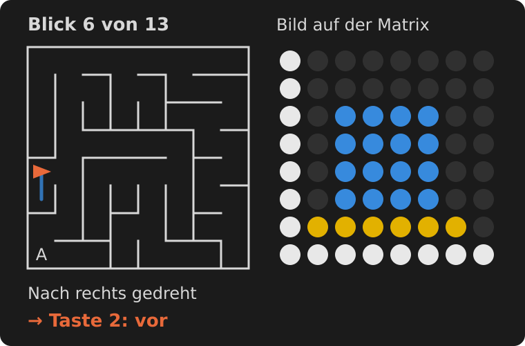
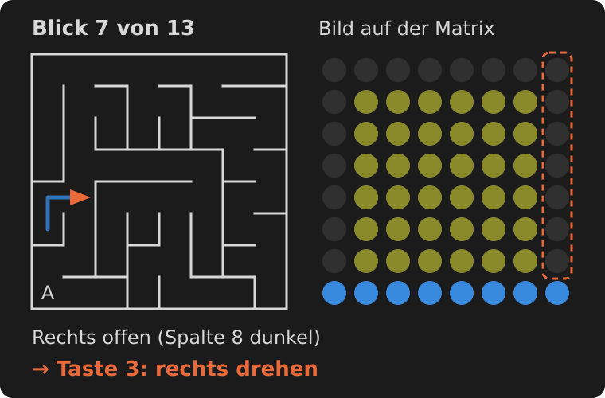 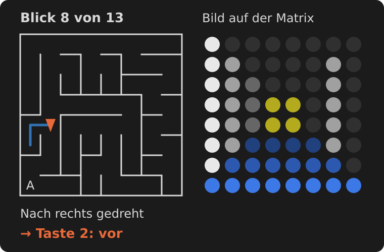
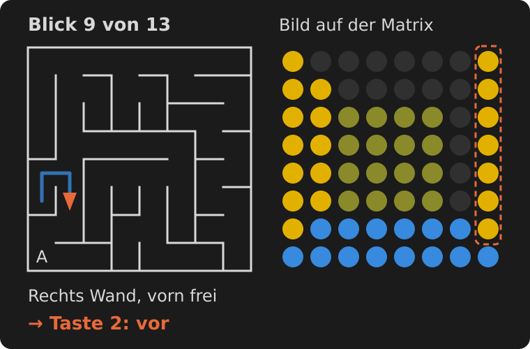 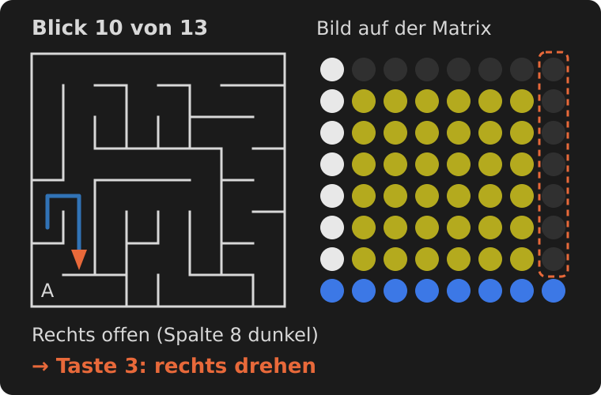
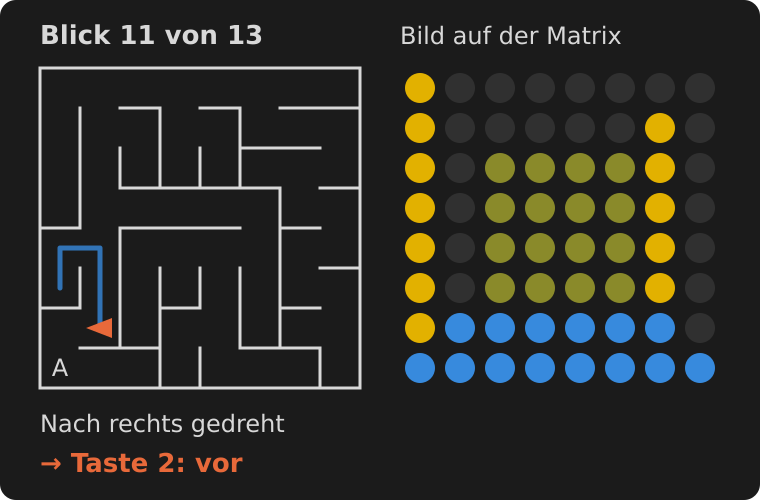 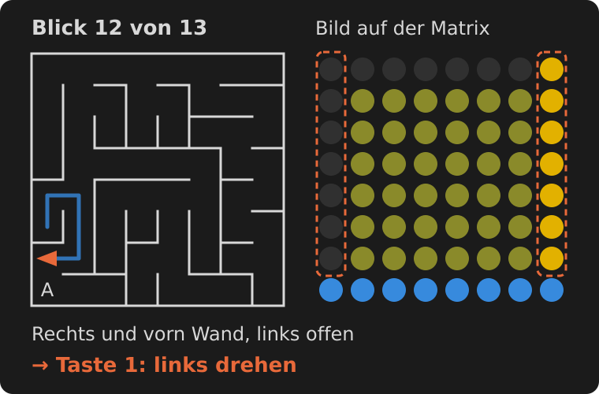
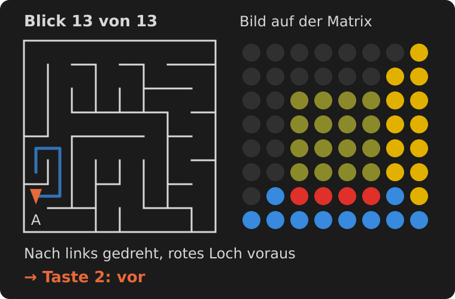

Mit der Taste 2 in Blick 13 geht man in den Ausgang, und das Programm würfelt den nächsten Irrgarten aus. Der ganze Weg:

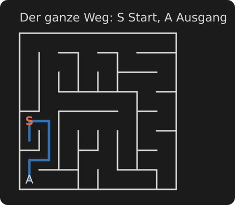

### Was das Beispiel zeigt

- **Geprüft wird nur beim Betreten eines Raums.** Nach einer Drehung (Blick 2, 4, 6, 8, 11, 13) folgt immer sofort Taste 2, ohne neu zu prüfen.
- **Blick 1 und Blick 6 sind dasselbe Bild**, verlangen aber verschiedene Tasten. In Blick 1 steht man neu im Raum und prüft: rechts offen, also drehen. In Blick 6 hat man sich gerade gedreht. Die dunkle Spalte 8 ist jetzt der Gang, aus dem man kommt, nämlich die Sackgasse von Blick 3. Wer hier noch einmal prüft und wieder nach rechts dreht, läuft in die Sackgasse zurück.
- **Sackgassen gehören dazu** (Blick 3 und 4). Die Regel führt hinein und wieder heraus, das ist kein Fehler.
- **Das rote Loch im Boden** (Blick 13) zeigt den Ausgang voraus. Sieht man es früher, darf man die Regel verlassen und geradeaus hineingehen.
- **Vor einer Wand tut sich nichts:** Taste 2 ändert dann das Bild nicht. Erst schauen, ob vorn frei ist, sonst verzählt man sich.
- **Auf das Bild warten:** Ein Blick braucht etwa 3 Sekunden. Die nächste Taste erst drücken, wenn das Bild steht.
- **Hand nie wechseln:** Wer zwischendurch auf links umsteigt, läuft dieselben Gänge noch einmal ab.

## Technik

- **Speicher:** 1 Bit je Raum in den 16 Speicherregistern M0-MF. Bit 1 heißt Durchgang nach Osten. Die Bits teilen jede Reihe in Stücke, und aus jedem Stück führt genau ein Durchgang nach Norden: in den ungeraden Reihen am Ostende, in den geraden am Westende. Dadurch zeigen die Winkel reihenweise abwechselnd nach links und rechts.
- **Zeichnen:** Am Start legt das Programm die Farben des Userscripts auf den Stapel der Matrix. Je Blick sendet es ein Bild im Blockmodus (Wände und Boden) und zeichnet die Stirnwand als Rechteck. Das Loch am Ausgang färbt es vorher rot, nur in den Farben der Matrix: Seine LEDs leuchten als Boden schon, und es erscheint mit der Stirnwand zugleich. Gleich danach holt es die Farben vom Stapel zurück. Das ändert die Anzeige nicht, die Stirnwand bleibt sichtbar, aber im Speicher der Matrix stehen wieder die Grundfarben.
